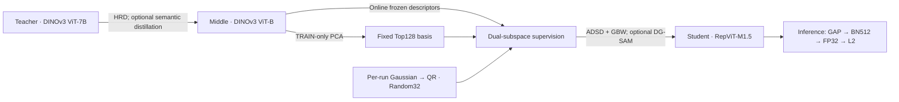

# Lora-Pyra-Geo

**Progressive distillation for UAV–satellite cross-view geo-localization**

Transfer a DINOv3 ViT-7B Teacher to a DINOv3 ViT-B Middle Teacher, then to a
RepViT-M1.5 Student. The Student learns from complementary Top128 and Random32
subspaces and retrieves images with a single 512-dimensional descriptor.

[Method](#method) · [Results](#results) · [Installation](#installation) ·
[Data and weights](#data-and-pretrained-weights) · [Training](#training) ·
[Evaluation](#evaluation) · [Reproduction guide](docs/reproduction.md) ·
[Evaluation protocol](docs/evaluation.md)

> **Release status.** Training and evaluation code is available in this repository.
> Public checkpoint downloads, the paper citation and the final repeated-run
> summary have not been published here. The results below refer to identified,
> completed runs; they do not include unfinished experiments.

## Method

The two resolution-matched pipelines are **T224 → M224 → S224** and
**T256 → M256 → S256**. All stages train on University-1652. SUES-200 and the
two GTA-UAV test splits evaluate transfer without fine-tuning on those datasets.



- **Teacher adaptation.** Blocks 1–20 remain frozen, blocks 21–36 use LoRA,
  and blocks 37–40 are fully fine-tuned. The config uses zero-based,
  end-exclusive intervals `[20,36)` and `[36,40)`.
- **Teacher → Middle.** Hard-rank distillation (HRD) transfers relative
  similarities using Teacher-selected hard negatives. Optional semantic
  distillation uses Teacher layers 28/36 and Middle layer 10 as configured.
  M3 and M4 add KD-guided standard SAM.
- **Middle → Student.** TSD denotes Top-Subspace Distillation; ADSD denotes
  Asymmetric Dual-Subspace Distillation. The Top128 branch uses a residual
  MLP (`512 → 920 → 128`), while Random32 uses a linear predictor
  (`512 → 32`). Learnable gradient-based balancing (GBW) weights the branches.
- **DG-SAM.** The first pass uses KD alone to construct the perturbation;
  the second optimizes the full task-plus-KD objective. The standard L2 radius
  is `rho=0.10`.
- **Deployment.** The Middle/Teacher provider, projection heads and GBW gate
  are training components. Student retrieval uses only the Student encoder.

Top128 is fitted once from the selected provider's **training-set** descriptors.
Random32 is sampled once per run and stays fixed throughout that run; it is
neither a per-batch PCA nor a new random projection at every iteration.

## Results

The following values are from the completed **T0 → M3 → S3-M3** runs, using
the repository's [documented evaluation protocol](docs/evaluation.md).
All R@1 values are percentages. GTA columns are D2S retrieval, not localization
distance. Each row is one selected checkpoint, **not a mean over random bases**.

<!-- MAIN_RESULTS_START -->
| Model | Input | U1652 D2S R@1 | U1652 S2D R@1 | GTA cross-area R@1 | GTA same-area R@1 |
| --- | ---: | ---: | ---: | ---: | ---: |
| T0 | 224 | 96.52 | 96.86 | 41.53 | 39.53 |
| T0 | 256 | 96.81 | 97.29 | 40.23 | 36.63 |
| M3 | 224 | 95.75 | 97.00 | 48.70 | 46.06 |
| M3 | 256 | 96.15 | 97.00 | 49.65 | 46.04 |
| S3-M3 | 224 | 91.96 | 94.72 | 40.81 | 38.34 |
| S3-M3 | 256 | 93.20 | 95.15 | 43.48 | 40.37 |
<!-- MAIN_RESULTS_END -->

[Detailed results and checkpoint identities](docs/results.md) include AP,
SUES-200 at all four heights, and GTA R@5/SDM/DIS.
Do not mix these unified-protocol measurements with paper-reported numbers
obtained under different gallery, precision or augmentation settings.

## Installation

Run the commands below from a Linux checkout with an NVIDIA CUDA GPU:

```bash
git clone https://github.com/potato-ding/lora-pyra-geo.git
cd lora-pyra-geo

conda env create -f environment.yml
conda activate pyra_geo
```

The pinned environment uses Python 3.10, PyTorch 2.5.1 + CUDA 12.1,
torchvision 0.20.1 and DeepSpeed. See [environment.yml](environment.yml) and
[requirements.txt](requirements.txt) for the full dependency versions.
DeepSpeed CPUAdam requires a working compiler toolchain and CUDA toolkit;
a PyTorch CUDA wheel alone does not provide the build tools.
Use a BF16-capable GPU. The formal GPU/batch requirements are listed below;
they are execution settings, not measured minimum-memory specifications.

## Data and pretrained weights

Obtain the datasets and pretrained assets from their authors:

| Asset | Official source | Expected repository location |
| --- | --- | --- |
| University-1652 | [University1652-Baseline](https://github.com/layumi/University1652-Baseline) | `data/U1652/` |
| SUES-200 | [SUES-200-Benchmark](https://github.com/Reza-Zhu/SUES-200-Benchmark) | `data/SUES-200/SUES-200-512x512/` |
| GTA-UAV LR | [GTA-UAV / Game4Loc](https://github.com/Yux1angJi/GTA-UAV) | `data/GTA-UAV-LR/GTA-UAV-LR-baidu/` |
| DINOv3 source and ViT-7B/ViT-B weights | [DINOv3](https://github.com/facebookresearch/dinov3) | `src/models/dinov3_main/`, `src/models/dinov3-pth/` |
| RepViT-M1.5 pretrained weights | [RepViT](https://github.com/THU-MIG/RepViT) | `src/models/repvit/repvit_m1_5_distill_450e.pth` |

Datasets, pretrained weights and experiment outputs are not bundled in Git.
The [reproduction guide](docs/reproduction.md#data-layout) specifies directory
layouts and the exact pretrained filenames. Preserve the DINOv3 source version
used for a run; a newer upstream checkout is not a substitute for its recorded
source snapshot.

## Training

Training is configured by JSON; shell scripts select the config and visible
GPUs. **Before starting a new run, set a new `output_dir` and bind the intended
provider/assets.** The checked-in configs contain paths to existing local runs
and are not portable download manifests. Middle and Student launchers reject a
nonempty output directory.

| Stage | Configs | GPUs × pairs/GPU | Epochs | U1652 selection |
| --- | --- | ---: | ---: | --- |
| Teacher | `configs/teacher/t0_{224,256}.json` | 4 × 8 | 10 | Epochs 6–10 |
| Middle | `configs/middle_teacher/` | 2 × 16 | 10 | Epochs 6–10 |
| Student | `configs/student/` | 1 × 32 | 30 | Epochs 11–30 |

A pair contains one drone image and one satellite image. All stages use global
pair batch 32. Selection runs on one GPU with batch 16 and maximizes
**U1652 D2S R@1 + S2D R@1**. SUES-200 and GTA do not select checkpoints.

The example below shows the R256 M3 chain. Run each stage only after its inputs
have been prepared; the asset-building step is required before Student training.

```bash
# 1. Adapt the large Teacher.
CUDA_VISIBLE_DEVICES=0,1,2,3 bash scripts/train_teacher.sh \
  configs/teacher/t0_256.json

# 2. Bind the trained T0-256 checkpoint in this config, then train M3.
CUDA_VISIBLE_DEVICES=0,1 bash scripts/train_middle_teacher.sh \
  configs/middle_teacher/m3_sam_hrd_sem_256.json

# 3. Build Top128 and initialization calibration from this exact M3.
# See docs/reproduction.md, "Build Student supervision assets".

# 4. Bind the M3 checkpoint, matching config and assets, then train S3.
CUDA_VISIBLE_DEVICES=0 bash scripts/train_student.sh \
  configs/student/s3_sam_adsd_256.json
```

Use the matching `_224.json` files for R224 and rebuild resolution-specific assets.
The [complete recipe](docs/reproduction.md) covers asset commands, M0–M4,
S0–S4, M3/M4 supervision, repeated random bases, direct Teacher distillation,
and the files saved with each run.

## Evaluation

One command evaluates **University-1652 → SUES-200 → GTA cross-area →
GTA same-area**, sequentially on one GPU with batch 16:

```bash
conda activate pyra_geo
bash scripts/eval.sh --gpu 0 --model-type student \
  --checkpoint src/checkpoint/student/R256/S3-256-M3/best_model.pth \
  --image-size 256 --dataset all --data-root data
```

Use `--model-type teacher` or `middle` for the corresponding checkpoints.
For our models, `--image-size` must equal the training resolution.
Loading restores the recorded runtime precision and verifies the U1652
best-checkpoint metrics before issuing formal results.

```text
<run-directory>/
├── best_model.pth
├── train.log
├── test_1652.json
├── test_sues200.json
├── test_gta_cross_area_d2s.json
└── test_gta_same_area_d2s.json
```

Existing result files are protected. To complete a partially evaluated run, select
only its missing dataset/split; see [evaluation and recovery](docs/evaluation.md).
Comparison models use explicit adapters and their own input sizes through
`python -m src.evaluation.comparison`, documented on the same page.

## Repository guide

| Location | Purpose |
| --- | --- |
| [configs/](configs/) | Method, resolution and run-asset configuration |
| [scripts/](scripts/) | Training, asset-building, evaluation and efficiency entrypoints |
| [src/training/teacher/](src/training/teacher/) | Large Teacher adaptation and checkpoint selection |
| [src/middle_teacher/](src/middle_teacher/) | Middle training, HRD, semantic distillation and SAM |
| [src/student/](src/student/) | TSD/ADSD, GBW, Student SAM and supervision assets |
| [src/evaluation/](src/evaluation/) | Strict model loading, retrieval metrics and comparison adapters |
| [src/dataset/](src/dataset/) | Training data and shared evaluation loaders |
| [tests/](tests/) | Method, checkpoint, precision and metric contract tests |
| [docs/](docs/) | Reproduction, evaluation and result documentation |

## Reproducibility and validation

The checkpoint records its method/config, provider and asset identities, selection
metrics, precision signature and relevant source hashes. SHA-256 identifies exact
bytes; it is not a training hyperparameter. A new provider checkpoint requires
matching newly built assets. Keep the source revision and run records with the
checkpoint; do not rewrite old metadata to make it match edited source.

For a code check, use an **idle** GPU:

```bash
CUDA_VISIBLE_DEVICES=0 python -m pytest -q
git diff --check
for script in scripts/*.sh; do bash -n "$script"; done
```

The test suite does not launch formal training or full-dataset evaluation.
A small CUDA numerical test is skipped when CUDA is unavailable.
[Efficiency measurements](docs/evaluation.md#efficiency) are separate from
retrieval evaluation.

## Citation, release and acknowledgments

The paper title, author list and BibTeX entry will be added with the paper release.
Until then, identify this repository and the exact revision used; no publication
venue or acceptance status is claimed here. Public checkpoint download links
are not yet provided. A project-level license has not yet been added; third-party
code, pretrained models and datasets retain their own terms.

This work uses [DINOv3](https://github.com/facebookresearch/dinov3),
[RepViT](https://github.com/THU-MIG/RepViT),
[DeepSpeed](https://github.com/deepspeedai/DeepSpeed), and the
University-1652, SUES-200 and GTA-UAV benchmarks linked above.
The repository also builds on [repvit-uav](https://github.com/SAU-UAV-team/repvit-uav).
Comparison adapters preserve upstream attribution and document any compatibility
limitations in their loading records.
